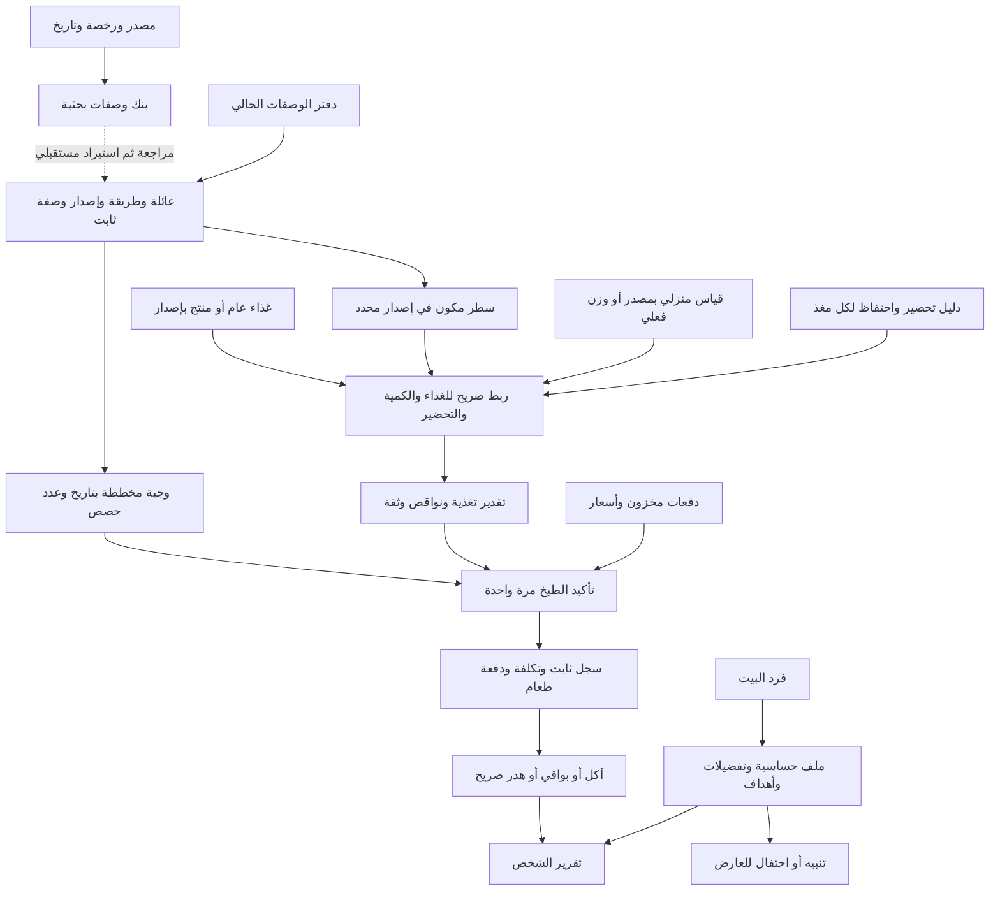

# خريطة بيانات سُفرة — مدخل واحد

13 أكتوبر 2026. نسخة العمل: `E:\work\SOFRA\app`؛ المرجع `origin/main`.
هذه خريطة الكود والبنوك الموجودة، مع فصلها عن الروابط المقترحة والعمل المتبقي. لا تعني أن واجهة الهاتف تعرض كل هذا بالفعل.

## المسار من الوصفة إلى الشخص

الخط المتقطع مسار لم يُنفّذ بعد. بنك الوصفات البحثية لا يدخل الحساب أو مخزون المستخدم تلقائيًا.

## ملفات الهيكل الفعلي

| المجال | النماذج المنفذة | المصدر |
|---|---|---|
| الوصفة والكميات والخطوات | `CatalogRecipe`, `CatalogIngredient`, `CatalogStep`, `ScaledCatalogRecipe` | [recipe_catalog.dart](../lib/domain/recipe_catalog.dart)، و[types.ts](../recipes/src/types.ts) للمكتبة الأصلية |
| عائلات وطرق وإصدارات | `RecipeFamily`, `RecipeRevision`, `RecipeBook` | [recipe_variants.dart](../lib/domain/recipe_variants.dart)، [دليل الإصدارات](RECIPE-VARIANTS.md) |
| الغذاء والمغذيات والمصدر | `FoodRecord`, `FoodSource`, `NutrientProfile`, `FoodConversion`, `PreparationTransform` | [food_nutrition.dart](../lib/domain/food_nutrition.dart) |
| ربط الوصفة بالغذاء | `RecipeFoodSelection`, `IngredientNutritionEstimate` | [recipe_nutrition.dart](../lib/domain/recipe_nutrition.dart)، [دليل المراجع](RECIPE-REFERENCES.md) |
| المخزون والتخطيط والمال | `InventoryLot`, `StockPurchase`, `PlannedMeal`, `BudgetPeriod`, `MoneyEntry` | [kitchen_core.dart](../lib/domain/kitchen_core.dart)، [قرارات المال](MONEY-RULES.md) |
| البلد والعملة والصياغة | `MarketProfile` | [market_profile.dart](../lib/domain/market_profile.dart) |
| الشخص والحصص والتفاعل | `NutritionPersonProfile`, `NutrientTarget`, `MealBatch`, `NutritionEvent`, `NutritionLedger` | [person_nutrition.dart](../lib/domain/person_nutrition.dart) |
| الحفظ والتنسيق | `KitchenService` الكاتب الوحيد؛ `StateStore` محلي أو لحساب Firebase | [kitchen_service.dart](../lib/data/kitchen_service.dart)، [state_store.dart](../lib/data/state_store.dart)، [API](BACKEND-API.md) |

## مفاتيح الربط التي يجب الحفاظ عليها

| الرابط | المفتاح والقيد |
|---|---|
| عائلة ← طريقة ← إصدار | `familyId` ثم `variantId` و`revision`؛ `RecipeRevision.key` هو JSON للزوج `[variantId, revision]`. لا توريث حي أو استبدال محتوى إصدار قديم |
| خطة ← وصفة | `PlannedMeal.recipeId` و`recipeRevisionKey`؛ القراءة عبر `recipeForMeal(planId)` |
| سطر ← غذاء | `recipeId + recipeRevisionKey + line` مع لقطة `FoodRecord.id/version`؛ رقم السطر مهم لأن ingredientId قد يتكرر |
| مخزون ← استخدام | `InventoryLot.id/ingredientId` وكمية بوحدة قابلة للتحويل؛ اسم المكون لا يحدد ماركة الغذاء تلقائيًا |
| طبخ ← تاريخ | `operationId` يمنع الخصم المكرر، ويجمد الوصفة والكميات والسعر والتغذية؛ التخطيط وحده لا يخصم |
| شخص ← تغذية | `NutritionPersonProfile.memberId` يطابق `HouseholdMember.id`؛ لا إنشاء شخص آخر من شكل الشخصية |
| حصة ← دفعة وشخص | `NutritionEvent.batchId/personId`؛ `personId` يطابق فرد البيت، مع هوية حدث وتصحيح إلحاقي؛ الطبخ لا يسجل الأكل تلقائيًا |

## البنوك الحالية وحدودها

| البنك | مكانه | الوضع |
|---|---|---|
| الوصفات المستخدمة حاليًا | [recipes/data/index.json](../recipes/data/index.json) وملفات المطابخ الأربعة | 54 وصفة أصلية محفوظة؛ 605 أسطر مكونات. ليست كلها ذات تغذية مكتملة |
| وصفات جديدة من مصادر | [data/recipes/research-candidates.json](../data/recipes/research-candidates.json) | 6 مرشحات/61 سطرًا/46 خطوة من مجموعتي مصدر؛ بنك بحث منفصل،0 جاهزة لـruntime؛ صيغة وفحوص في [RECIPE-BANK.md](RECIPE-BANK.md) |
| USDA | [manifest](../data/usda/manifest.json) و32 ملفًا في `data/usda/shards` | 8156 مرجعًا عامًا؛ CC0، لا يمثل توافر المنتج في سوق معين |
| منتجات Open Food Facts | `data/food/openfoodfacts/`، [PRODUCT-DATA.md](PRODUCT-DATA.md) | 1793 منتجًا/55 أرشيفًا في آخر نقطة موثقة؛ مجتمع وغير مراجع، أساس القياس مجهول؛ ODbL/DbCL منفصل |
| تغطية ومقترحات هوية الوصفات | [recipe-coverage.json](../data/usda/recipe-coverage.json)، [RECIPE-REFERENCES.md](RECIPE-REFERENCES.md) | 197 مقترح هوية عبر53 وصفة؛ **0 ربط تغذية كامل معتمد**. قبول الهوية وحده لا يحل الوزن والتحضير |
| مقاييس منزلية | [household-measures-review.json](../data/nutrition/household-measures-review.json)، [HOUSEHOLD-MEASURES.md](HOUSEHOLD-MEASURES.md) | 36 غذاء/103 خيارات؛ قبول صريح حسب الغذاء وشكله والإصدار، و6 فجوات بلا خيار |
| التحضير | [retention-candidates.json](../data/nutrition/retention-candidates.json)، [PREPARATION-EVIDENCE.md](PREPARATION-EVIDENCE.md) | 9 مرشحات لـ3 طرق و3 فيتامينات؛ مراجعة فئتين للمكرونة في [preparation-category-review.json](../data/nutrition/preparation-category-review.json)، **0 تحويلات runtime معتمدة**؛ الوزن الناتج وبقية المعاملات مجهولة |

الأعداد لقطة تسليم وليست حدود اكتمال. المصدر والإصدار والترخيص وتاريخ الجمع وحالة المراجعة جزء من البيانات؛ لا نخزن المجهول صفرًا. نخزن49 مغذيًا، ونُظهر5: السعرات، البروتين، السكريات، الألياف، الدهون الكلية مرة واحدة.

## الموجود في الحفظ وما يزال مطلوبًا

- `KitchenService` يحفظ حالة المستخدم فقط عبر `StateStore`؛ مسار Firestore الحالي `users/{uid}/state/current`. البنوك الكبيرة أصول محلية ولا تُنسخ كاملة إلى هذا المستند. حد850KB يحتاج أرشفة تاريخ منفصلة لاحقًا.
- آليات الإصدار والربط والتأكيد والحصص موجودة. مراجعة كل وصفة وملصق، أدلة التحضير الكاملة، التغذية الجاهزة للأطباق، وإيصال هذه APIs بالواجهة الخارجية ما زالت غير مكتملة.
- بنك أسعار موثق، مخطط تلقائي متوازن، قواعد طبية مراجعة، كاميرا باركود وOCR فواتير، وأمان تخزين البواقي مراحل مستقلة؛ لا تُستنتج من الاسم أو البلد.
- أول عمل للوصفات الجديدة: مراجعة المصدر والترخيص، المقادير والمفردات والوحدات، مدد الخطوات وسياسة تغييرها مع الحصص، ثم استيراد إصدار كامل وربط كل سطر. وقت الفرن ودرجة الحرارة لا يصبحان مدة مؤكدة بمجرد استدعاء دالة scaling الحالية.

## بقية الوثائق

[الهيكل الغذائي المفصل](FOOD-DATA-ARCHITECTURE.md) · [ربط الواجهة](BACKEND-API.md) · [إصدارات الوصفات](RECIPE-VARIANTS.md) · [خطة البحث](RESEARCH-ROADMAP.md) · [قائمة العمل](WORK-QUEUE.json) · [الحالة](STATUS.md) · [التسليم](HANDOFF.md)
