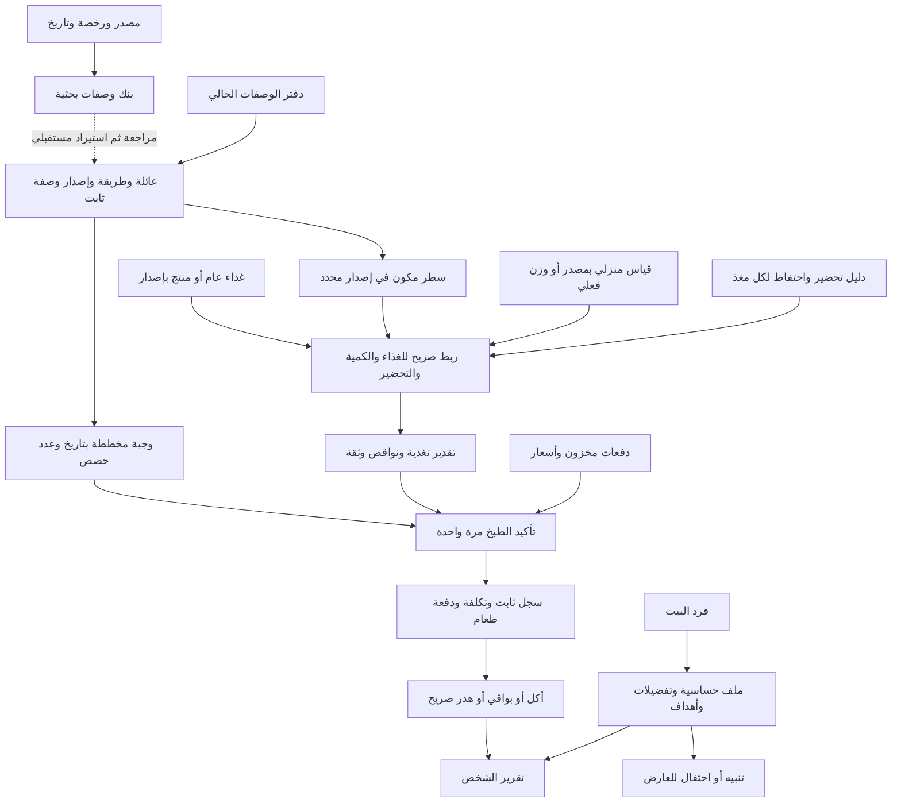

# خريطة بيانات سُفرة — مدخل واحد

13 أكتوبر 2026. نسخة العمل: `E:\work\SOFRA\app`؛ المرجع `origin/main`.
هذه خريطة الكود والبنوك الموجودة، مع فصلها عن الروابط المقترحة والعمل المتبقي. لا تعني أن واجهة الهاتف تعرض كل هذا بالفعل.

## المسار من الوصفة إلى الشخص

الخط المتقطع مسار لم يُنفّذ بعد. بنك الوصفات البحثية لا يدخل الحساب أو مخزون المستخدم تلقائيًا.

## ملفات الهيكل الفعلي

| المجال | النماذج المنفذة | المصدر |
|---|---|---|
| الوصفة والكميات والخطوات | `CatalogRecipe`, `CatalogIngredient`, `CatalogStep`, `ScaledCatalogRecipe` | [recipe_catalog.dart](../lib/domain/recipe_catalog.dart)، و[types.ts](../recipes/src/types.ts) للمكتبة الأصلية |
| عائلات وطرق وإصدارات | `RecipeFamily`, `RecipeRevision`, `RecipeBook` | [recipe_variants.dart](../lib/domain/recipe_variants.dart)، [دليل الإصدارات](RECIPE-VARIANTS.md) |
| الغذاء والمغذيات والمصدر | `FoodRecord`, `FoodSource`, `NutrientProfile`, `FoodConversion`, `PreparationTransform` | [food_nutrition.dart](../lib/domain/food_nutrition.dart) |
| ربط الوصفة بالغذاء | `RecipeFoodSelection`, `IngredientNutritionEstimate` | [recipe_nutrition.dart](../lib/domain/recipe_nutrition.dart)، [دليل المراجع](RECIPE-REFERENCES.md) |
| المخزون والتخطيط والمال | `InventoryLot`, `StockPurchase`, `PlannedMeal`, `BudgetPeriod`, `MoneyEntry` | [kitchen_core.dart](../lib/domain/kitchen_core.dart)، [قرارات المال](MONEY-RULES.md) |
| البلد والعملة والصياغة | `MarketProfile` | [market_profile.dart](../lib/domain/market_profile.dart) |
| الشخص والحصص والتفاعل | `NutritionPersonProfile`, `NutrientTarget`, `MealBatch`, `NutritionEvent`, `NutritionLedger` | [person_nutrition.dart](../lib/domain/person_nutrition.dart) |
| الحفظ والتنسيق | `KitchenService` الكاتب الوحيد؛ `StateStore` محلي أو لحساب Firebase | [kitchen_service.dart](../lib/data/kitchen_service.dart)، [state_store.dart](../lib/data/state_store.dart)، [API](BACKEND-API.md) |

## مفاتيح الربط التي يجب الحفاظ عليها

| الرابط | المفتاح والقيد |
|---|---|
| عائلة ← طريقة ← إصدار | `familyId` ثم `variantId` و`revision`؛ `RecipeRevision.key` هو JSON للزوج `[variantId, revision]`. لا توريث حي أو استبدال محتوى إصدار قديم |
| خطة ← وصفة | `PlannedMeal.recipeId` و`recipeRevisionKey`؛ القراءة عبر `recipeForMeal(planId)` |
| سطر ← غذاء | `recipeId + recipeRevisionKey + line` مع لقطة `FoodRecord.id/version`؛ رقم السطر مهم لأن ingredientId قد يتكرر |
| مخزون ← استخدام | `InventoryLot.id/ingredientId` وكمية بوحدة قابلة للتحويل؛ اسم المكون لا يحدد ماركة الغذاء تلقائيًا |
| طبخ ← تاريخ | `operationId` يمنع الخصم المكرر، ويجمد الوصفة والكميات والسعر والتغذية؛ التخطيط وحده لا يخصم |
| شخص ← تغذية | `NutritionPersonProfile.memberId` يطابق `HouseholdMember.id`؛ لا إنشاء شخص آخر من شكل الشخصية |
| حصة ← دفعة وشخص | `NutritionEvent.batchId/personId`؛ `personId` يطابق فرد البيت، مع هوية حدث وتصحيح إلحاقي؛ الطبخ لا يسجل الأكل تلقائيًا |

## البنوك الحالية وحدودها

| البنك | مكانه | الوضع |
|---|---|---|
| الوصفات المستخدمة حاليًا | [recipes/data/index.json](../recipes/data/index.json) وملفات المطابخ الأربعة | 54 وصفة أصلية محفوظة؛ 605 أسطر مكونات. ليست كلها ذات تغذية مكتملة |
| وصفات جديدة من مصادر | [data/recipes/research-candidates.json](../data/recipes/research-candidates.json) | 6 مرشحات/61 سطرًا/46 خطوة من مجموعتي مصدر؛ بنك بحث منفصل،0 جاهزة لـruntime؛ صيغة وفحوص في [RECIPE-BANK.md](RECIPE-BANK.md) |
| الوصفات بالجملة | [الفهرس](../data/recipes/bulk/wikibooks-cookbook/index.json)،[مراجعة الهوية](RECIPE-IDENTITY-REVIEW.md) | 3640وصفة/3796صفحة/53تصنيف؛16اقتراحًا/22مرشحًا/5أغذية؛0runtime؛المصدر الحالي انتهى والتوسيع مستمر |
| USDA | [manifest](../data/usda/manifest.json) و32 ملفًا في `data/usda/shards` | 8156 مرجعًا عامًا؛ CC0، لا يمثل توافر المنتج في سوق معين |
| منتجات Open Food Facts | `data/food/openfoodfacts/`، [PRODUCT-DATA.md](PRODUCT-DATA.md) | 2266 منتجًا/63 أرشيفًا في آخر نقطة موثقة؛ مجتمع وغير مراجع، أساس القياس مجهول؛ ODbL/DbCL منفصل |
| تغطية ومقترحات هوية الوصفات | [recipe-coverage.json](../data/usda/recipe-coverage.json)، [RECIPE-REFERENCES.md](RECIPE-REFERENCES.md) | 197 مقترح هوية عبر53 وصفة؛ **0 ربط تغذية كامل معتمد**. قبول الهوية وحده لا يحل الوزن والتحضير |
| مقاييس منزلية | [household-measures-review.json](../data/nutrition/household-measures-review.json)، [HOUSEHOLD-MEASURES.md](HOUSEHOLD-MEASURES.md) | 36 غذاء/103 خيارات؛ قبول صريح حسب الغذاء وشكله والإصدار، و6 فجوات بلا خيار |
| التحضير | [retention-candidates.json](../data/nutrition/retention-candidates.json)، [PREPARATION-EVIDENCE.md](PREPARATION-EVIDENCE.md) | 9 مرشحات لـ3 طرق و3 فيتامينات؛ مراجعة فئتين للمكرونة في [preparation-category-review.json](../data/nutrition/preparation-category-review.json)، **0 تحويلات runtime معتمدة**؛ الوزن الناتج وبقية المعاملات مجهولة |

الأعداد لقطة تسليم وليست حدود اكتمال. المصدر والإصدار والترخيص وتاريخ الجمع وحالة المراجعة جزء من البيانات؛ لا نخزن المجهول صفرًا. نخزن49 مغذيًا، ونُظهر5: السعرات، البروتين، السكريات، الألياف، الدهون الكلية مرة واحدة.

## الموجود في الحفظ وما يزال مطلوبًا

- `KitchenService` يحفظ حالة المستخدم فقط عبر `StateStore`؛ مسار Firestore الحالي `users/{uid}/state/current`. البنوك الكبيرة أصول محلية ولا تُنسخ كاملة إلى هذا المستند. حد850KB يحتاج أرشفة تاريخ منفصلة لاحقًا.
- آليات الإصدار والربط والتأكيد والحصص موجودة. مراجعة كل وصفة وملصق، أدلة التحضير الكاملة، التغذية الجاهزة للأطباق، وإيصال هذه APIs بالواجهة الخارجية ما زالت غير مكتملة.
- بنك أسعار موثق، مخطط تلقائي متوازن، قواعد طبية مراجعة، كاميرا باركود وOCR فواتير، وأمان تخزين البواقي مراحل مستقلة؛ لا تُستنتج من الاسم أو البلد.
- أول عمل للوصفات الجديدة: مراجعة المصدر والترخيص، المقادير والمفردات والوحدات، مدد الخطوات وسياسة تغييرها مع الحصص، ثم استيراد إصدار كامل وربط كل سطر. وقت الفرن ودرجة الحرارة لا يصبحان مدة مؤكدة بمجرد استدعاء دالة scaling الحالية.

## بقية الوثائق

[الهيكل الغذائي المفصل](FOOD-DATA-ARCHITECTURE.md) · [ربط الواجهة](BACKEND-API.md) · [إصدارات الوصفات](RECIPE-VARIANTS.md) · [خطة البحث](RESEARCH-ROADMAP.md) · [قائمة العمل](WORK-QUEUE.json) · [الحالة](STATUS.md) · [التسليم](HANDOFF.md)

## French source expansion —16:56

| Source bank | Path | Coverage |
| --- | --- | --- |
| French Wikibooks research | [index](../data/recipes/bulk/fr-wikibooks-cuisine/index.json), [source contract](RECIPE-FRENCH-SOURCE.md) | 1218 source pages/838 parsed recipes/5849 ingredient lines/5319 steps; CC BY-SA4.0 policy, exceptions unreviewed;0runtime/nutrition approvals |

French language is not a cuisine tag. Source IDs/cursors remain separate; duplicates between English/French or dish families are not resolved. Personal recipe calculation still needs explicit food/quantity/form inputs; this research source does not automatically fill them.

## Additional identity curation

[first-review.json](../data/recipes/identity-proposals/first-review.json) plus [spices-leavening-review.json](../data/recipes/identity-proposals/spices-leavening-review.json):16distinctproposals/16recipes/22candidate references/5rawUSDAfoods,0accepted or runtime-ready. Cinnamon/baking-soda records preserve source/food hashes and soaking/draining unknowns. Both banks are research-only;French still has no identity proposals.

## Latest source snapshot

French450parsed/625pages/2862ingredientlines/2591steps;English3640/3796/53tagsunchanged. SourceIDs/licences/cursorsseparate;cross-languageduplicatesunresolved. Identitybanks16proposals/16recipes/22references/5foods,0accepted/runtime;OFF2266/63. LatestFrenchgate2026-10-13T17:49:47.599Z;readactualcheckpoints. SeeHANDOFF§43–44.

## Validated catalog entry point

[identity catalog](../data/recipes/identity-proposals/catalog.json) + `tool/recipes/validate-identity-catalog.mjs`: explicit three-bank inventory, exact bytes/current source-food checks, cross-bank target dedup,24targets/22recipes/9foods/50refs/1withoutcandidates/0runtime. Only registered English-source banks are included; French source counts remain separate.

## Source alternatives registered

[alternatives-review.json](../data/recipes/identity-proposals/alternatives-review.json) adds8lines to [catalog.json](../data/recipes/identity-proposals/catalog.json);qualifiedvegan identity unresolved,no automatic substitution or nutrient sum. Actualaggregate3/24/22/9/50/1/0runtime. Frenchliteralcategorylabels have explicitraw-vs-parsed denominators inHANDOFF§46;not cuisineclaims.

CurrentFrenchsnapshot:804/1169,allcanonicalquantities/nutritionunreviewed. English3640/3796unchanged;catalog3/24/22/9/50/1/0runtime. No combinedunique-dishcount;source continuation/quotachecks inHANDOFF§47.

Heartbeat18:29 snapshot:French838/1218,English3640/3796/catalog3/24/22/9/50/1/0runtimeunchanged. Sourceavailable;actualquota90reserve delays research,not a sourcefailure. SeeHANDOFF§48.

## Current checkpoint — heartbeat21:29 UTC

French inventory completed: 1489 source pages/1011 conservatively parsed recipes/7128 ingredient lines/6408 steps/128 request archives. SourceExhausted=true, no pending IDs, no listing continuation. English3796/3640 unchanged. Next licensed source discovery remains open; no source cursor reset or final bank count cap, no combined unique-dish sum.

New [ingredient-fate research](RECIPE-INGREDIENT-FATE.md) pins2source ingredient lines and6method steps; retained amounts and nutrient factors remain null,0runtime approvals.18linked tests/current source validators passed. Existing identity catalog3/24/22/9/50/1/0 unchanged. OFF2266/63 unchanged,503 gates saved. See HANDOFF§49 for exact requests, verification and next actions.

Spanish discovery now archived:3official API responses,CC BY-SA4.0 site policy,49first-prefix entries,0parsed recipes. [Source and next collector contract](RECIPE-SPANISH-SOURCE.md);HANDOFF§50. Consume archived firstlisting before continuation;no cuisine inference or exhausted-source reset.

## Spanish collector checkpoint — heartbeat21:59

[Spanish source contract](RECIPE-SPANISH-SOURCE.md) and data/recipes/bulk/es-wikibooks-recipes/index.json: 1043sourcepages/853parsed/6750ingredientlines/4981steps/85requestarchives. Parserv3/23tests/currentSHA+re-extraction+bootstrap49checks passed. Pending0,sourceExhausted=True,nextAttemptAt=None;read actual checkpoint. Research-only,0runtime/nutrition approvals;English/French/otherbanks unchanged,no combined unique-dish sum. Next:After actual quota/owner checks,discover Spanish singular Artes culinarias/Receta/ via bounded archived namespace0 nonredirect listing,using verified Spanish site policy;review scope/parser before collection. Then another licensed pool if needed. Preserve exhausted plural/English/French cursors,0runtime approvals. SeeHANDOFF§51.

## Explicit single ingredient choice API

[RECIPE-INGREDIENT-CHOICES.md](RECIPE-INGREDIENT-CHOICES.md): KitchenService.chooseRecipeIngredient creates one caller-reviewed quantified replacement as a new personal revision. Source/full snapshot/region/method and complete expected recipe guarded;old plans/history frozen,no inherited nutrition bindings.7newtests/full107Fluttertests/analyzeclean. Research source promotion and private from-scratch creation remain separate.

## Import-draft audit checkpoint

[Source import-draft preflight](RECIPE-IMPORT-PREFLIGHT.md) now reports explicit exact-line quantity/form/choice/optional/reference/time review.29linked tests passed; English blank-template baseline3640/31774/24964,0runtime. A complete draft is not a nutrition or runtime approval. Next registered reviewed draft persistence and adapter gates; no UI/state/import changes. HANDOFF§54.

Registered source-draft continuation: [preflight/registry contract](RECIPE-IMPORT-PREFLIGHT.md);1explicit persisted blank draft/9lines/50issues/0complete/0runtime,36linkedtests passed. Exactnext: source-to-runtime adapter with required metadata/provenance and unresolved nutrition/form/retention gates. HANDOFF§55; no auto-discovery or guessed data.

## Structural adapter checkpoint

[Runtime candidate contract](RECIPE-RUNTIME-ADAPTER.md): explicit complete source drafts/metadata become CatalogRecipe-shaped candidates with full source/licence/line maps and remaining gates.44linkedNode+1actualFlutterreader/scalingpassed;analyzeclean. Transport validation rebuilds against currentauthoritativeinputs. No KitchenService import/nutritionapproval yet;next native provenance reader/immutable registration. OFF2287/64(+21/1),5banktestspassed;Saudi503gate23:49:13.371Z. HANDOFF§56.

## Native source import checkpoint

[Native import API/compatibility](NATIVE-RECIPE-IMPORT.md) now verifies exactUTF8 transport/source envelope and persists selectedreviewed roots atomically through KitchenService.importSourceRecipe. Full142Flutter+1additionalnutritionbinding/46Node/analyzeclean;no actualsourcebankpromotion/UI/usercloudwrites/automaticnutritionbindings. Quantity/import infrastructuredone;scientificcoverage remainsopen,preparation30next,privateauthoring34unblocked. OFF2378/67(+91/3),5actualbanktests;sourcegates incheckpoint. HANDOFF§58.

## Explicit category preparation acceptance —14 October2026

See [PREPARATION-ACCEPTANCE.md](PREPARATION-ACCEPTANCE.md). PreparationCategoryRepository verifies the exact generic USDA168927/asSold/version snapshot, LF-normalized whole-shard SHA, pinned review/source and selected candidate rows. Explicit actual method0381 or0382 acknowledgement creates an estimated transform with3vitamins only,46missing factors/nullmassYield/edibleFraction and unknown source-specific licence. It is a category inference, not exact-food/legal/finished-recipe approval.

KitchenService.acceptRecipePreparationEstimate freezes exact recipe/revision/line scope, checks stale async plan/binding and atomic failure/retry, and requires explicit replacement rather than layering methods. confirmCooking(acknowledgePreparationEstimates:true) is required only for included accepted-estimate lines, even with actual weighed grams. History stores estimatedPreparationLines/preparationEstimateEvidence and confidence; stock deduction remains once-only, no person intake. Input-only preview remains before cooking. No UI/Firebase/APK integration. Full155Flutter+6sourceNodepassed,analyzeclean;scientificcoverage staysopen. HANDOFF§59.

## Personal from-scratch drafts —14October2026

[PERSONAL-RECIPE-DRAFTS.md](PERSONAL-RECIPE-DRAFTS.md): owned explicit food/quantity/form/optional/scaling/estimate inputs with unknown cuisine/time/food/amount. KitchenService saves immutable reviewed versions/active pointers without a CatalogRecipe parent, exact expectedActiveKey, same-key collision protection, idempotent older retries and failed-save/850KB rollback. Typed sorted-object fingerprint survives storage map reordering. Separate ingredient/cooked previews use existing calculator. No automatic planning, stock or intake; accepted preparation scoped to another recipe cannot be copied. Full171Flutter/analyzeclean,8domain+8persistence cases. Finalization into a plannable recipe remains next under authoring34; do not invent metadata zeros or a parent. HANDOFF§60.

## Reviewed draft publication —14October2026

[PERSONAL-RECIPE-PUBLICATION.md](PERSONAL-RECIPE-PUBLICATION.md) supersedes the earlier unimplemented bridge checkpoint. PersonalRecipeFinalization owns the full draft, explicit metadata/durations/inventory IDs/review and canonical derived IDs. KitchenService.finalizePersonalRecipe publishes an authored root and exact food selections atomically from the saved active draft, with expected active recipe guard and immutable retries. Existing planning/cooking now works; no fake parent, stock/intake on publication, UI/cloud activation or automatic scientific approval. Missing metadata, unsupported estimated quantities and base precision loss reject; unknown food remains unknown. Full183Flutter/analyzeclean. Older clients do not support authored kind. HANDOFF§61.

## Price and recipe expansion —14October2026

[PRICE-SOURCES-EG-SA.md](PRICE-SOURCES-EG-SA.md): 34research observations (EG30/SA4), source partitions/licences, declared-unit calculator and explicit comparability/evidence gates;0runtime prices. Source dossiers in data/prices/research/{egypt,saudi}-sources.json; deterministic observations.json; Open Prices ODbL raw/probe separate. No KitchenService integration yet.

[RECIPE-EXPANSION-AR-DE.md](RECIPE-EXPANSION-AR-DE.md): Arabic1candidate/8lines/6steps; German250fixed source revisions/177candidates/1493lines/998steps. Own archived lanes/indexes,0runtime/nutrition/cuisine approvals; exact cursors/incident/guards documented. No cross-language unique-dish count.

## Historical ranges and ongoing recipe delta

Priceintervals are a separatekind: official/msit-2025-06-ranges.json has36June2025retailranges, not34currentquotes or an average. official-price-ranges.mjs requires explicitperiod/country/unit and retains0runtime. SourcePDFexternalcache/SHA/page/rightsunknown documented in PRICE-SOURCES-EG-SA.md. Existing34pointresearch observations unchanged.

DEsource now550pages/375candidates/3287lines/2146steps; cursorKochbuch/_Pesto. See RECIPE-EXPANSION-AR-DE.md for formatbugred/green and actualbatchprovenance. Language/sourcecounts not uniquedishes.

Latest source-language acquisition: 700 source revisions / 481 records under review / 4121 ingredient lines / 2784 preparation lines; cursor Kochbuch/_Sexy_Cupcake;0runtime/nutrition/cuisine approvals. Source-wide OFF access scheduling shared by source-access.mjs/collector/watchdog; current401gate09:49:45.471Z, no new product/price data.

Heartbeat09:16: 850 fixed source pages / 544 records under review / 4635 ingredient lines / 3136 preparation lines; German source lane/index and agent handoffs authoritative.0runtime. GASTAT use-policy direct retry still502; no new licence or prices inferred. HANDOFF§65.

Current recipe acquisition policy: RECIPE-ACQUISITION-ARABIC-YOUTUBE.md (official modern Arabic YouTube sources, explicit dish-family/method grouping, provenance and nutrition review). Further book-source acquisition stopped by user. Catalogue54/4cuisines;research6056beforededup;verifiedmulti-methodgroups0. Historical source banks remain separate and unapproved.

##14أكتوبر — نتيجة المعالجة بدل عدد سجلات البحث

RECIPE-LIBRARY.md:6056بحث قديم →16مراجعة عربية محلية +6من مواقع طهاة رسميين →قارئ Flutter مثبت بالبصمات للعرض والبحث(22سجلًا)، مع حفظ حالات4مكتملة/10مراجعة/2ناقصة محليًا.11وسم منطقة/مطبخ مصدر، عائلة نان بطريقتين؛ لا زيادة تلقائية إلى54وصفة التخطيط أو ربط غذائي. ملفات المصدر ودفتران عربيان وأربع مسودات preflight وروابط كل سجل محفوظة. منيوتيوب14فيديو/4ناقص/0كامل. FEATURE-STATUS.md يوضح المبني والجزئي والمتبقي.

من خطط الوجبات إلى المال:KitchenService.previewPurchases →تجميع مطلوب الوصفات→توزيع المخزون مرة واحدة→شراء النواقص منفصلًا عن قيمة الاستهلاك؛ بيانات ناقصة تمنع الإجمالي المكتمل، لا تعديل مخزون أو تاريخ.

##14October — market-first source correction

Latest user priority: real retailer and delivery-app prices first; government sources are secondary, no waiting for government exports. See MARKET-PRICE-INTEGRATIONS.md, new official-source EG/SA dossiers, and offline partner-catalog-candidates.mjs (8tests). Talabat/HungerStation partner scope is own chain/vendor; Salla/Zid can read consenting merchant catalogs. No live feed or reuse permission acquired. GASTATJuly2026 workbook/100food rows saved as raw source checkpoint only; no normalized/livepricebank/currency approval. Arabiccreatorsecondbatch adds2website recipes with explicit source omissions;22bundled readable entries unchanged, nextassetintegration separate.

## Current library/private-calculator map — §71

5selected recipe packs → flutter-manifest.json +trusted Dart SHA → RecipeLibraryRepository (31readable entries/20upstream snapshots) → RecipeLibraryDraftReview (full dedicated source envelope +explicit every-line decisions) → KitchenService atomic librarySource/draft persistence → existing PersonalRecipeDraft calculator. Source-backed publication is separately gated. Contract: LIBRARY-RECIPE-CALCULATOR.md; source status/counts: RECIPE-LIBRARY.md. Existing54planning recipes/4cuisines and food banks are separate. No automatic food, rights or nutrient acceptance follows from reading an entry.

## Current §72 banks

44readable library records=28local+16creatorwebsite;7pinnedpacks/28upstream snapshots. _source in recipe_library_draft.dart now keeps exactmatching creator/list attribution in persisted evidence. New allergen research bank data/food/allergen-evidence/20261014/official-evidence.json links source→anchored claim→exact vocabulary mapping proposal;7claims/15proposals,2retrievedSFDA sources and2failedaccess checkpoints. SA historical menu scope only,EG unknown;0runtime product/alias/clinical/current-law approval. Existing FoodRecord declarations remain separately evidenced perrecord/source/version.

## Current source/calculator/evidence map — §75

9selected recipe packs +36source snapshots → original-byte manifest pins → RecipeLibraryRepository (55readable=36archive+19creatorwebsite) → explicit every-line RecipeLibraryDraftReview → atomic KitchenService private draft → existing nutrition calculator. Original54planning catalog and source-rights publication gate remain separate. RECIPE-LIBRARY.md has current counts; prior sections are historical.

6manufacturer source attempts →4product observations →13contains/3mayContain statements → original-byte pinned ProductLabelEvidenceRepository → typed read-only research search/inspection. Proposed vocabulary and null local SKU/market/GTIN/nutrition are preserved. No automatic FoodRecord or clinical decision. PRODUCT-LABEL-EVIDENCE.md defines boundary. OFF access form draft is separate from product/recipe work.
