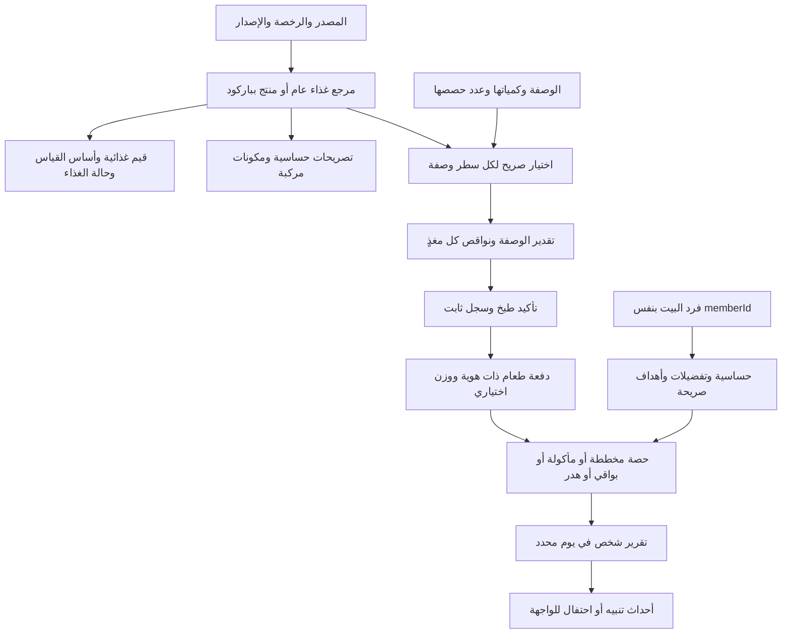

# سُفرة — هيكل الغذاء والأشخاص والحساب والتفاعل

12 أكتوبر 2026. نسخة العمل الوحيدة `E:\work\SOFRA\app`. هذا وصف للكود والبيانات الحالية مع حدودها، وليس ضمان اكتمال بيانات السوق أو دقة توصية طبية. الواجهات لم تُعدّل.

> تحديث: نسخ الوصفات المثبتة وربط التغذية حسب الإصدار موضحة في RECIPE-VARIANTS.md. أعداد قسم البنك أدناه لقطة البداية التاريخية؛ manifest.json وPRODUCT-DATA.md مرجع أحدث1793منتج.

## 1. العلاقات الأساسية



## 2. الكيانات المنفذة

| الكيان | الهوية والمحتوى | قواعد أساسية |
|---|---|---|
| `FoodSource` | مصدر، URL، رخصة، تاريخ استرجاع، إصدار ومعرّف المصدر | كل مرجع مصدر مستخدم في الغذاء يجب أن يكون موجودًا |
| `FoodRecord` | id/version، عام أو معبأ، أسماء، ماركة/سوق/GTIN، عبوة، حالة raw/cooked/asSold/prepared | الباركود له checksum؛ لا مساواة بين ماركتين أو نسختين بالاسم |
| `NutrientProfile` | أساس محدد بالجرام أو المل أو الحصة أو مجهول، وقيم ذات وحدات ثابتة | المجهول ليس صفرًا؛ `<` وtrace لا تتحول إلى رقم دقيق |
| `FoodConversion` | كثافة أو وزن حبة/حصة أو الجزء المأكول مع مصدر | لا تحويل كوب أو حبة إلى جرام بالتخمين |
| `PreparationTransform` | حالة قبل/بعد، عائد وزن اختياري، احتفاظ لكل مغذٍ مع مصدر | تغير الوزن بسبب الماء لا يعني فقد/زيادة البروتين أو اعتماد احتفاظ تلقائي |
| `AllergenDeclaration` | يحتوي/قد يحتوي/تصريح خلو/مجهول، مع دليل | عدم كتابة الحساسية لا يعني الخلو؛ المكونات المركبة والمراجع الناقصة تظل مجهولة |
| `FoodComponent` | foodId+version ونسبة كتلة اختيارية | بيان المكونات لا يحل محل القيم الغذائية على العبوة؛ لا نجمع بيانات المركب ومكوناته مرتين |
| `RecipeFoodSelection` | recipeId + recipeRevisionKey + رقم السطر، لقطة الغذاء وحالته وقياس صريح اختياري | نفس ingredientId قد يكون نيئًا أو مطبوخًا أو خليطًا أو بدائل في وصفات مختلفة |
| `RecipeNutritionResult` | بصمة محتوى الوصفة، الحصص، وزن الناتج إن قيس، كامل المدخلات والنتائج | لكل مغذٍ مجموع معروف واكتمال وأسباب النقص |
| `NutritionPersonProfile` | نفس HouseholdMember.id، عمر مصرح أو تاريخ ميلاد، حساسية وتفضيلات وأهداف | لا إنشاء شخص ثان ولا اشتقاق احتياج من شكل الشخصية أو الجنس |
| `NutrientTarget` | عنصر ووحدة وحد أدنى/أعلى، مصدر user/clinician، فترة وتاريخ مراجعة | لا تتداخل أهداف العنصر في نفس الفترة؛ لا نستنتج هدفًا من ملاحظة صحية |
| `MealBatch` | دفعة مستقلة، مصدر لقطة، قيم غذائية مجمدة، وزن ناتج اختياري | تقدير توزيع متجانس؛ مكونات طبق غير متجانس تسجل كدفعات منفصلة عند الحاجة |
| `NutritionEvent` | eventId، دفعة، شخص عند الأكل، تاريخ، actorId، حصة، نوع وتعديل سابق | سجل إلحاقي وتصحيحات بلا محو التاريخ؛ actorId نسبة التسجيل وليس توقيعًا تشفيريًا |
| `NutritionLedger` | الدفعات والأحداث | تخطيط منفصل عن مأكول؛ منع التكرار والتجاوز وإعادة الحساب مرتين |

## 3. المغذيات والتعريفات

السجل المنفذ يحتوي49 معرّفًا: الطاقة kcal/kJ، البروتين، الدهون وأنواعها، الكربوهيدرات بتعريفاتها، الألياف، السكريات والسكريات المضافة، النشا، polyols، الماء، الكحول كحقل بيانات مصدر، الصوديوم والملح والكوليسترول، المعادن والفيتامينات والكولين.

**قرار العرض المعتمد:** العرض الأساسي 5 قيم فقط بالترتيب: السعرات kcal، البروتين، السكريات الكلية، الألياف، الدهون الكلية مرة واحدة. تظل49خانة غذائية محفوظة للمستقبل؛ لا عرض مستقل لأنواع الدهون أو الكربوهيدرات أو الصوديوم في الملخص الأساسي. المجهول لا يصبح صفرًا. يستخدم المصمم `primaryDisplayNutrients` من النواة؛ لا تغيير للواجهة الحالية بهذه الدفعة.

- الكربوهيدرات العامة على بعض الملصقات منفصلة عن `carbohydrateByDifference` في USDA و`availableCarbohydrate`. لا جمع تعاريف مختلفة ولا طرح ألياف تلقائيًا لتوحيدها.
- vitamin A العام وRAE والريتينول والبيتاكاروتين منفصلة، وكذلك الفولات وDFE وحمض الفوليك وفولات الغذاء. لا تحويل تكافؤ بلا معامل موثق.
- الصوديوم بالـmg والملح بالـg؛ تحويل وحدة منشورة صريح فقط، وليس اختراع عنصر مفقود من الآخر.
- لا نحسب سعرات بديلة من الماكروز لتعويض طاقة المصدر الناقصة.
- لا استخدام قيم مصنفة مجهولة/trace/أقل من كرقم كامل. نقص مغذٍ لا يلغي مجموع البروتين المعروف في بقية المكونات، لكنه يمنع عرض المجموع الناقص كإجمالي مكتمل.

## 4. الحساب والطبخ

1. يختار المستخدم/مراجع البيانات الغذاء الفعلي لكل سطر: نوع اللبن، نسبة دهن اللحمة، الرز النيئ/المطبوخ، المنتج وإصداره.
2. يراجع المقدار والوحدة والجزء المأكول، والتحويلات المنزلية عند الحاجة. قياس سطر التغذية الصريح يستخدم لحل وحدة غير مدعومة أو مقدار غير معروف؛ لا يستبدل مقدارًا بالجرام معروفًا دون تغيير الوصفة نفسها.
3. يحدد الاختياري الذي استُخدم بالفعل. الفحم أو مادة غير مأكولة يمكن استبعادها بإقرار وسبب؛ لا تستخدم الاستبعاد لإخفاء زيت القلي الممتص أو مكون ناقص.
4. يحدد حالتي المصدر والقياس والتحضير، ومعاملات الاحتفاظ ذات المصدر إن كانت مطلوبة. لا افتراض أن حرارة الفرن لا تغير المغذيات.
5. لكل مغذٍ: قيمة المصدر × كمية الغذاء / أساس المصدر × الجزء المأكول × معامل الاحتفاظ عند وجوده. تجمع المساهمات القابلة للحساب وتُسجل النواقص.
6. الحصة القياسية = إجمالي الدفعة / عدد الحصص المصرح. هذه **وحدة عرض**، وليست توزيعًا تلقائيًا على أفراد البيت.
7. لكل100جرام لا يحسب إلا عند تحديد وزن الناتج. لا يستبدل وزن المكونات النيئة وزن الصينية بعد الخَبز.
8. `confirmCooking` يجمّد التغذية الحالية والدفعة والمخزون والسعر والسجل في حفظ واحد. إعادة نفس operationId ترجع نفس السجل، حتى لو تغيرت الأسعار أو ربط الغذاء لاحقًا. الطبخ لا يسجّل أن كل شخص أكل.

البواقي/الهدر/المأكول نسب من نفس الدفعة ولا تتجاوز100%. قبل أكل بواقي مسجلة، يُسجّل تصحيح يقلل المتبقي ثم الأكل في **نفس استدعاء** `recordNutritionEvents`؛ لا خصم مكونات أو تكلفة طبخ ثانية. طبق غير متجانس قد يحتاج تقسيم مكوناته أو وزنها، ولا نقدم الدقة الحسابية كتوزيع مقاس فعلًا.

## 5. الأشخاص والتفاعل

- ملف التغذية مرتبط بالشخص الموجود بالفعل. شخص واحد صالح. العمر اختياري وصريح، ولا يحسب احتياج الرضيع أو الطفل أو الحامل من الصورة/السن تلقائيًا.
- الحساسية منظمة مع الشدة وسياسة التلوث المتبادل ومصدر وتاريخ. أسماء مرادفة واضحة موحدة؛ القمح منفصل عن الجلوتين، والمكسرات لا تُستنتج من صور الطعام.
- الملاحظات مثل «برد» أو «سكر» تحفظ كنص ولا تؤدي وحدها لمنع أطعمة أو تغيير علاج أو وضع أهداف طبية.
- `mealInteractions` يصدر تعارض حساسية/احتمال تلوث/بيانات مجهولة. احتفال الأكلة المفضلة اختياري، ولا يصدر لو توجد مشكلة حساسية معروفة أو مجهولة لهذا الشخص.
- `targetInteractions` يقارن قيمًا مكتملة بوحدتها الصحيحة وفترتها، بعد إقرار اكتمال تسجيل اليوم؛ اليوم الجزئي ينتج unknown. موعد المراجعة ينتج needsReview.
- الأحداث لها IDs ثابتة لتجنب تشغيل الاحتفال مرتين. العارض يختار الحركة؛ **لم يضف هذا العمل صوتًا أو رسومًا أو توصيات علاجية**.
- تفاصيل حساسية HouseholdMember القديمة النصية لا تتحول إلى قواعد منظمة بالتخمين؛ الواجهة الجديدة تراجعها وتربط ملف التغذية بنفسID.

## 6. بنك البيانات الحقيقي وحدوده

### USDA — مستقل برخصةCC0

- 8,156 سجلًا مرجعيًا:363 سجلًا صالحًا منFoundation2026 و7,793 منSR Legacy2018؛ المصدر الأول يحتوي32 قيمة سجل فارغة عُزلت.
- قيم المصدر لكل100جرام من الجزء المأكول، وأوزان الحصص المنشورة، وتفاصيل المغذيات والتحليل محفوظة في32shard. تمثيل مضغوط بالقوائم يقلل تكرار أسماء المغذيات دون حذف قيم المصدر.
- هذه مراجع أمريكية تشمل أغذية محضرة وسجلات تاريخية؛ ليست قائمة منتجات متاحة أو حلال في مصر والسعودية.
- `data/usda/manifest.json` يحفظ المصدر والإصدار وSHA256؛ ملفاتZIP الأصلية خارجGit. أداة إعادة الاستيراد `tool/usda/import_usda.py`.
- وحدة مصدر تالفة مثلU+FFFD لا تتحول تلقائيًا إلىug في طبقة الحساب؛ قيمها الأصلية محفوظة وتحتاج تحقق مصدر الوحدات. طاقةFoundation بأرقام أخرى لا تخمن من1008 المفقود.

### Open Food Facts — بنك منتجات منفصل

- 687باركودًا مسمى صالحًا،20فئة؛320مصر و374السعودية بينهما7مشتركة. لا ادعاء أنها كل السوق أو ترتيب الأكثر مبيعًا.
-510فيها بيانات مغذيات،461ماكروز أساسية،329نص مكونات،179تصريحات حساسية،108ماركة ناقصة. الباقي يبقى مجهولًا، والمنتج بلا ماركة يحتاج مراجعة قبل تحويله إلىFoodRecord محدد.
- بيانات مجتمع، غير مراجعة لدينا. `_100g` قد تعني100g أو100ml؛ أساسها مجهول حتى مراجعة دليل العبوة، ولا نستنتجه من حجم العبوة.
- `packagedFood` يحتفظ بتقديرية البيانات، ويحوّل الوحدات المتوافقة فقط. تحذيرات التعارض الجوهري تمنع قيمًا كاملة؛ مراجعة الأساس وحده لا تصلح أخطاء جدول التغذية. التصحيح الكامل يحتاجFoodRecord جديدًا ذا مصدر مراجعة.
- رخصةODbL/DbCL محفوظة منفصلة عنUSDA وكود التطبيق، مع الأرشيفات والإسناد والمصدر والتاريخ والبصمات. لا صور منتجات نُسخت. انظر `docs/PRODUCT-DATA.md` لشروط إعادة استخدام قاعدة مشتقة وتوسيعها.
-15طلب فئات رجعت503 وسُجلت دون إعادة متكررة. تغطية السوق والتركيبة الحالية ليست مؤكدة بمجرد وجود باركود.

### تغطية وصفات سُفرة

كل54وصفة لها قائمة مراجعة:605سطرًا و145ingredientId. الملف `data/usda/recipe-coverage.json` يغطيها كلها، و**عدد الربط المؤكد الجاهز0**؛ لأن الأسماء المشتركة والبدائل والحالات والوحدات لا تكفي لربط صحيح تلقائي.

المنطق جاهز لاستقبال الربط الصريح وحسابه. هذا العمل لا يدعي أن صينية البشاميل جاهزة الآن بتقرير مكتمل داخل الواجهة أوAPK. الخطوة التالية مراجعة سطور البشاميل أولًا بمكوناتها الفعلية وتحويلاتها، ثم باقي الوصفات، مع عرض نسبة/نواقص التغطية لكل مغذٍ.

## 7. API للواجهة الأخرى

```dart
final bank = FoodRepository();
final candidates = await bank.search(query: 'rice');
final food = await bank.usdaFood('usda:169756', form: 'raw');
// اختيار المراجع صريح. لا تعمم هذا النوع على كل وصفة تستخدم rice.
await kitchen.saveRecipeFoodSelection(RecipeFoodSelection(
  recipeId: recipe.id, line: lineIndex, food: food,
  amountForm: FoodForm.raw, preparedForm: FoodForm.cooked,
  preparation: reviewedTransform, // معاملات بمصدر؛ المفقود يبقى فجوة
));
final report = await kitchen.previewNutrition(planId);
final receipt = await kitchen.confirmCooking(planId, operationId,
  cookedYieldGrams: measuredCookedWeight);
// التغذية تجمد بالتأكيد؛ الحصص الفعلية تُسجّل بأحداث منفصلة.
await kitchen.recordNutritionEvents(events: [explicitPortionEvent]);
```

`KitchenService` هو الكاتب الوحيد. `nutrition` امتدادversion1 داخلkitchen/schema1، يحتويprofiles/selections/ledger؛ بنك الغذاء الكبير أصول محلية ولا يُنسخ إلىFirestore. لا تشغله مع كاتب الواجهة القديمة. حفظ فاشل لا ينشر حالة جديدة. حد850KB مبكر لمستند الحالة يرفض الحفظ دون حذف تاريخ؛ نقل التاريخ لاحقًا إلى مجموعات أحداث مستقلة يحتاج ترحيلًا وتصميمًا منفصلًا، ولم يغيّر هذا العمل قواعدFirebase.

الملفات: `food_nutrition.dart` للنواة، `person_nutrition.dart` للأشخاص والسجل، `recipe_nutrition.dart` للربط، `food_repository.dart` لتحميل المصادر، `kitchen_service.dart` للحفظ الذري. الاختبارات: `food_nutrition_test.dart` و`person_nutrition_test.dart` و`nutrition_integration_test.dart`، واختبارات أداة استيراد المنتجات.

## 8. حدود وتوسعة مقصودة

- لم تُبن واجهة الغذاء أو مراجعة الملصقات أو أهداف غذائية تلقائية أو تشخيص أو optimizerللوجبات/الميزانية.
- مصدر الأسعار مستقل عن مصدر التغذية؛ أسعار المستخدم قبل المتوسط، والسجلات المؤكدة ثابتة، والميزانية للمشتريات الجديدة فقط.
- lotالمخزون الحالي لا يختار تلقائيًا ماركة الغذاء؛ يجب اختيار المنتج المستخدم فعليًا قبل التأكيد. استخدام أكثر من ماركة لنفس المكوّن يحتاج مدخلات مفصلة بالقياس، ولا نفترض التجانس.
- تواريخ الصلاحية وفتح العبوة وسلسلة التبريد وتقييم أمان البواقي، وشهاداتحلال/حمية، قواعد مستقلة تحتاج مصادر ومراجعة؛ لا يستنتجها البنك من الاسم أو البلد أو عدم الحساسية.
- الباركود هنا معرّف وبحث؛ لا كاميرا سكان أوOCRفواتير تمت إضافتها. إضافة منتج لاحقًا تحفظ مصدره وإصداره ولا تعدل طبخًا سابقًا.
- مجال الأهداف والفترات يدعم أهدافًا مدخلة بصراحة؛ وضع قيم مرجعية حسب العمر/الوزن أو الحمل/المرض يحتاج مرحلة مراجعة علمية منفصلة.

## 9. مصادر المنهج

- [USDA أنواع البيانات](https://fdc.nal.usda.gov/data-documentation/) و[توثيقFoundation](https://fdc.nal.usda.gov/Foundation_Foods_Documentation/): الفروق بين الحالات والقياسات والتعاريف، ومنها الكربوهيدرات.
- [USDA التحميل والإصدارات](https://fdc.nal.usda.gov/download-datasets/) و[APIوالرخصة](https://fdc.nal.usda.gov/api-guide/).
- [FDA الحساسية والتلوث المتبادل](https://www.fda.gov/food/nutrition-food-labeling-and-critical-foods/food-allergies): مرجع لفصلContains/MayContain، وليس تطبيق قواعد تنظيمية أمريكية على كل بلد.
- مصادرOFFوتراخيصها وقيودها في `docs/PRODUCT-DATA.md`؛ لا نصوص علمية منسوخة ولا قيم غذائية مختلقة.


## تحديث ربط المراجع —13October2026

RECIPE-REFERENCES.md يشرح197مقترح هوية/53وصفة، القبول الصريح والحفظ الذري، حماية الإصدار/المصدر وتقدير المكونات المنفصل عن المطبوخ. ليست تغذية وصفات مكتملة؛ القيم غير المعروفة تبقى مجهولة.

## تحديث محرك الوصفات والثقة —13 أكتوبر2026

بنك بالجملة: 2312 وصفة مستخرجة/2428 صفحة مصدر/52 تصنيف؛ RECIPE-BULK.md يشرح طبقات المصدر/المشتق/الفهرس. محرك وصفة المستخدم ومستقبله في RECIPE-ENGINE.md. قيمةFoodRecord مستقلة عن الوصفة؛ بعد اختيار الغذاء والكمية يعاد الحساب، ولا ربط مؤكد بالاسم وحده.

PreparationTransform يحملestimatedودليلJSONاختياري؛ NutrientTotalينقل التقدير من التحضير/الكمية/طريقة المصدر إلىMealBatch ثمPersonNutrientValueوتقريرالشخص. trueلوجود مساهمة تقديرية،falseلعدم تعليمها كتقديرية وليس يقينًا معمليًا،nullلثقةlegacyغيرمسجلة.اكتمال التغطية محور مستقل. قبول تقدير التحضير المراجَع لم ينفذ، ولا مسودة from-scratch محفوظة.

OFFأحدث1936/58أرشيفًا،كل الأسس غيرمراجعة؛ الأعداد القديمة أعلاه تاريخية.100Flutter/analyzeنجحا في هذه الوحدة،ولاواجهة/APK/Firebaseتغيرت.


## Research identity reader checkpoint —13October

3640source-extracted recipes/3796pages/53sourcecuisine tags,0runtime approvals.8identity proposals/14candidates/3USDA raw records have independent recipe/food provenance and full snapshot guards. See RECIPE-IDENTITY-REVIEW.md. Actual8156rawUSDA snapshots checked;75recipeNode tests passed. Do not treat raw snapshot hashes as transformed runtime FoodRecord hashes; no quantity/clinical facts inferred.

## Current source-bank snapshot —13October17:26UTC

OFF2266products/63archives,allbasisunreviewed; licence/provenance unchanged. Independent French recipe research112parsed/139pages,canonicalquantity/nutritionnull; English3640/3796 unchanged. These counts do not establish unique dishes or approved nutrition. See RECIPE-FRENCH-SOURCE.md and HANDOFF§42.
