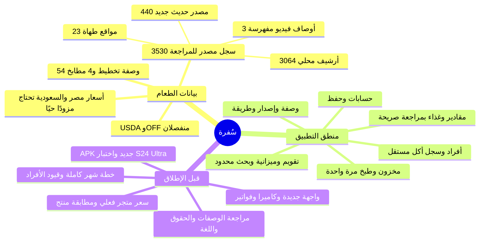

# سُفرة الآن — جدول وخريطة ذهنية

16 أكتوبر 2026. نسخة التطبيق الوحيدة `E:\work\SOFRA\app`. الأعداد هنا تخص كود ومصادر نسخة العمل الحالية؛ إتاحة الشيء للمستخدم في واجهة الهاتف أو اعتماده للتغذية مرحلة منفصلة. الدليل التنفيذي التفصيلي في `HANDOFF.md`، وخريطة البيانات في `DATA-MAP.md`.

| المجال | المبني والمتحقق | ما يلزم حتى يصبح تجربة مكتملة |
|---|---|---|
| الحسابات والحفظ | حسابات وحفظ محلي/سحابي على مشروع `sofra-c03a1` المخصص، ونسخة APK اختبارية سابقة | ربط الواجهة النهائية، فحص الجهاز والإصدار الجديد قبل توزيع APK جديد؛ لا تغيير Firebase أو فوترة بهذه الدفعة |
| وصفات التخطيط | 54 وصفة في 4 مطابخ: مصري 12، شامي 14، سعودي 14، إيطالي 14؛ عائلة نان واحدة بطريقتين مراجعتين | توسيع الوصفات المعتمدة فعليًا وإدخال مصادر جديدة بعد مراجعة المقادير والخطوات والحقوق |
| مكتبة مصادر الوصفات | 3530 سجلًا مقروءًا: 3064 من أرشيف مُعالج محليًا، 440 اكتسابًا جديدًا من Based Cooking، 23 من مواقع طهاة، 3 أوصاف فيديو مفهرسة. 22 حزمة/3504 لقطة مصدر؛ 71 وسم فئة مصدر محلية | السجلات ليست 3530 طبقًا فريدًا ولا جاهزة للتخطيط. 3440 سجلًا إنجليزيًا غير مترجم؛ إكمال المراجعة والترجمة والتصنيف الموثق. لا وصفة كاملة مجلوبة مباشرة من فيديو حتى الآن |
| عائلات الوصفات والتأليف | إصدارات ثابتة وطرق بديلة ومسودات شخصية وحفظ ونشر بمراجعة صريحة | ربط تدفق المستخدم في الواجهة؛ رفع عدد العائلات متعددة الطرق بعد تحقق المصدر |
| المقادير والغذاء | محرك حساب وأدلة USDA ومراجعة سطر المكون والكمية والشكل والتحضير، مع حفظ اللقطة المصدرية | 30828 سطرًا يحتاج مراجعة كمية من 30919؛ 0 موافقة تغذية تلقائية أو وصفات مصدر جاهزة للتشغيل. المجهول يبقى مجهولًا |
| الأفراد والحساسيات | ملفات أشخاص وأهداف غذائية وقيود مدخلة صراحةً؛ السجل الغذائي يفصل الطبخ عن أكل الفرد | تغطية علمية وشخصية قابلة للمراجعة؛ لا استنتاج طبي من اسم الوصفة أو الملصق |
| المخزون والطبخ | دفعات وكميات وأسعار معروفة/مجهولة، تأكيد طبخ واحد، خصم ذري، تاريخ ثابت وبواقي | إدخال البيانات الفعلية ومراجعتها وربطها بالواجهة الجديدة |
| التخطيط والميزانية | تقويم يوم/أسبوع/شهر، بدائل شهرية يحددها المستخدم، بحث محدود بعدد محاولات وتفضيلات تنوع/تكرار مع خانات يوم/وجبة يحددها المستخدم صراحةً، ومعاينة مشتريات تخصم الموجود حسابيًا | توليد خطة شهر كاملة وفق تغطية الوجبات والأفراد والسعر الحقيقي؛ لا تعديل خطة أو شراء تلقائيًا |
| أسعار مصر والسعودية | مشاهدات بحثية تاريخية ونطاقات مؤرخة، وسعر المستخدم له الأولوية | مزود متجر حي بعينة فرع وسلعة ووقت ووحدة وحقوق استخدام؛ لا سعر سوق حالي معتمد |
| المنتجات الغذائية | USDA 8156 سجلًا، OFF 2378 سجلًا محفوظًا؛ المنتج يحتاج هوية وسوق وملصق مطابقين | استكمال الوصول المصرح، مطابقة الباركود والمراجعة؛ خطأ المصدر لا يعطل منطق الوصفات |
| الواجهة والكاميرا | واجهة قديمة ونموذج تصميم خارجي؛ الباركود حاضر كهوية بيانات | بناء واجهة التصميم الجديدة ومسح كاميرا/OCR وفواتير بمراجعة المستخدم؛ لا تنفيذ ضمن هذه الدفعة |

**تعريف العدد:** الرابط أو صفحة الفهرس ليست وصفة؛ يُحسب سجل المصدر إذا احتوى مكونات وخطوات. هذا لا يثبت تميز الطبق دلاليًا ولا قبول الكمية/التغذية/الحقوق/التخطيط. دفعة Based Cooking الجديدة 440 فعلية، أقل من هدف 1000 بمقدار 560 لأن المصدر المثبت يحوي 440 مقبولة فقط. الألف الثالثة من الأرشيف تحويل محلي لا اكتساب جديد.
