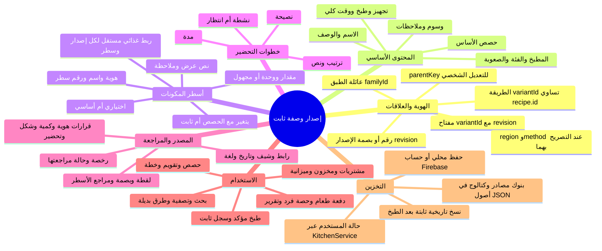
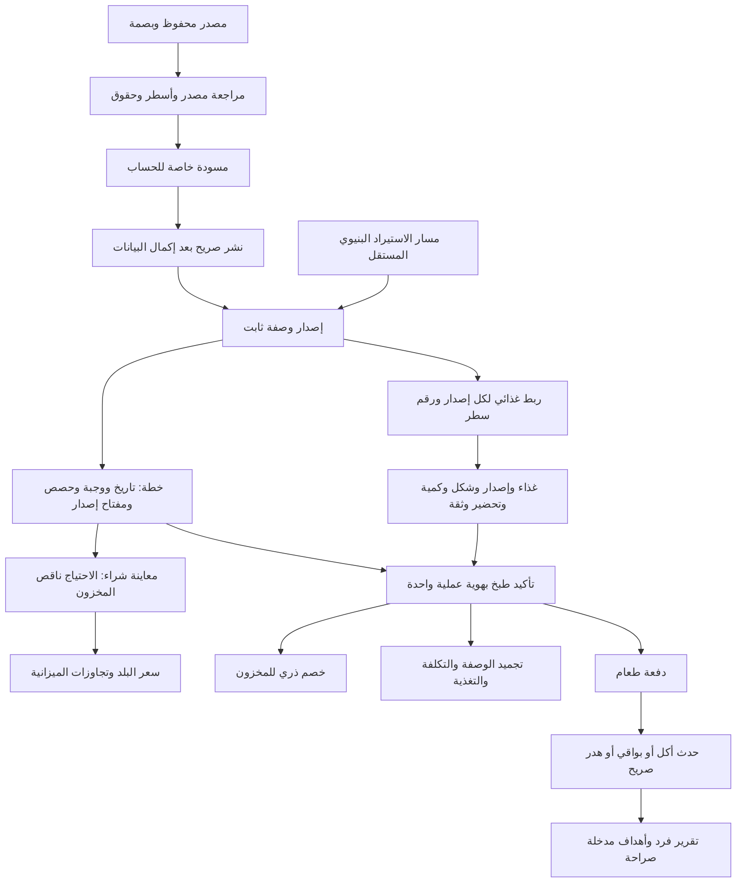

# خلية الوصفة في سُفرة — الهيكل الفعلي

21 أكتوبر 2026؛ مراجعة للكود الحالي على أساس `8012d79`. هذه خريطة بيانات، وليست تغييرًا في واجهة التطبيق. البحث الجاري يضيف أدلة مصدر، ولا يحولها تلقائيًا إلى وصفات تخطيط.

**الوحدة التي يعاد استخدامها هي إصدار وصفة ثابت `RecipeRevision`، وليس اسم الطبق وحده.** العائلة تجمع الطبق، ومعرّف الطريقة يميز وصفته، والإصدار يثبت المقادير والخطوات كما كانت وقت الاستخدام. التغذية والتكلفة ناتجان مرتبطان بالسياق، وليسا رقمين ثابتين صالحين لكل شخص وبلد وحصة.

## التقسيم الفعلي: ليس كائن JSON واحدًا ضخمًا

| الطبقة | ما تحتويه فعلًا | ماذا تثبت؟ |
|---|---|---|
| `RecipeLibraryEntry` | هوية مصدر، عنوان، أسطر مكونات ومقادير قد تكون مجهولة، خطوات، أدلة مطبخ، المصدر الخام/لقطته وبيانات الحزمة | سجل بحث قابل للقراءة؛ `runtimeReady=false` و`nutrition=null` دائمًا |
| `RecipeLibraryDraftReview` | لقطة المصدر وبصمتها وقرار صريح لكل سطر، مع `PersonalRecipeDraft` خاص بالحساب | ما راجعه المستخدم للحساب؛ لا اعتماد تلقائي للطهي أو الحقوق أو التغذية |
| `PersonalRecipeDraft` | هوية وإصدار وبصمة، حصص، أسطر `RecipeFoodInput`، تعليمات وأوقات اختيارية | مسودة حساب تحتفظ بالمجهول وتستطيع معاينة مدخلات التغذية |
| `RecipeFamily` | `id`, `name` | تجميع طرق الطبق؛ التشابه في الاسم لا ينشئ العائلة تلقائيًا |
| `RecipeRevision` | `familyId`, `revision`, `kind`, `parentKey`, `region`, `method`، لقطة `CatalogRecipe` كاملة، وأدلة مراجعة الاستيراد/التأليف/التغيير إن وجدت | إصدار تشغيل ثابت؛ التعديل ينشئ إصدارًا جديدًا |
| `RecipeBook` | خرائط `families`, `revisions`, `active` | إصدارات إلحاقية واختيار الإصدار الحالي للاستخدامات المستقبلية |

لا توجد حاليًا فئة مستقلة اسمها `RecipeVariant`: معرّف الطريقة `variantId` هو `CatalogRecipe.id`. هذا تفصيل مهم عند بناء واجهة اختيار الطرق.

## ماذا يوجد داخل الإصدار؟

| القسم | الحقول الفعلية | قواعد مهمة |
|---|---|---|
| التعريف | `id`, `name`, `cuisine`, `category`, `description`, `difficulty`, `tags`, `notes` | المطبخ/الفئة نصوص؛ ليست شجرة تصنيف موحدة متعددة اللغات |
| الكمية والزمن | `servings`, `prepTime`, `cookTime`, `totalTime` | الحصص عدد صحيح موجب؛ الوقت الكلي يساوي التجهيز+الطبخ في نموذج التشغيل الحالي |
| كل مكون `CatalogIngredient` | `id`, `name`, `amount`, `unit`, `scale`, `optional`, `label`, `display`, `note` | غير المقاس `amount=null` ولا يتدرج تلقائيًا؛ الوحدة إلزامية مع مقدار؛ رقم السطر يميز المكون المكرر |
| كل خطوة `CatalogStep` | `n`, `text`, `duration`, `passive`, `tip` | ترتيب متصل يبدأ1؛ النص لا يربط الخطوة بالمكونات أو المعدات بشكل منظم |
| سياق الإصدار | `familyId`, `revision`, `kind`, `parentKey`, `region`, `method` | المفتاح الفعلي هو JSON للزوج `[variantId, revision]`؛ لا تعديل إصدار قديم |
| قرارات التغيير | `ingredientSplitReview`, `ingredientChoiceReview`, `sourceImportReview`, `authoredReview` | أدلة تغيير أو مراجعة، وليست حقيقة طبية أو توريثًا لربط غذائي قديم |

## الروابط التي تجعلها قابلة لإعادة الاستخدام

- **التخطيط:** `PlannedMeal.recipeId + recipeRevisionKey + servings + date + slot`. مفتاح الإصدار اختياري في النموذج لدعم الخطط القديمة؛عند غيابه يحل `_resolveMeal` الإصدار النشط أو الكتالوج. لا تضمن الخطة القديمة تثبيت إصدار لم تحفظه،بينما تاريخ تأكيد الطبخ يحتفظ بلقطته. التخطيط وحده لا يخصم مخزونًا.
- **الغذاء:** `RecipeFoodSelection` يربط `recipeRevisionKey + line` بلقطة `FoodRecord.id/version`، شكل الوزن والتحضير، القياس الفعلي/المقياس المنزلي ودليله، وقرار عدم الاستهلاك. `ingredientId` ليس إثباتًا لهوية غذائية أو ماركة.
- **التغذية:** تُحسب من المدخلات المختارة للحصص، مع اكتمال/نواقص وثقة تقديرية. يوجد49 مغذيًا؛ العرض المختصر5. النتيجة قبل الطبخ ليست تلقائيًا غذاء الطبق المطهو.
- **المال:** السعر يختلف حسب البلد ووحدة الشراء وسعر المستخدم والمخزون؛ سعر المستخدم قبل المتوسط. السعر المجهول لا يصبح صفرًا، والتاريخ يحفظ السعر الذي استُخدم وقت التأكيد.
- **التاريخ:** `operationId` يمنع تكرار تأكيد الطبخ. تُحفظ لقطة العائلة والإصدار والمقادير المستهلكة/المحذوفة/الاختيارية وأدلة القياس والتحضير والتغذية والتكلفة.
- **الأفراد:** الطبخ ينشئ `MealBatch`؛ الأكل للفرد حدث منفصل `NutritionEvent` بكمية/نسبة صريحة. لا تقسيم افتراضي بالتساوي بين أفراد البيت.

## أين تتخزن؟

| البيانات | المكان الفعلي |
|---|---|
| الكتالوج المدمج | `recipes/data/index.json` وملفات المطابخ، ويقرأه `RecipeRepository` |
| مكتبة البحث المختارة | حزم داخل `data/recipes/...`، مع `data/recipes/curated-local/flutter-manifest.json` وبصماتSHA256 ولقطات مصدر حيث توجد؛ يقرأها `RecipeLibraryRepository` |
| العائلات والإصدارات الخاصة | `kitchen.recipeBook` داخل حالة المستخدم: `families/revisions/active` |
| مسودات الحساب ومراجعة المصدر | `kitchen.personalRecipeDrafts` بإصدارات وبصمات ومراجعات مصدر |
| الاختيارات الغذائية | `kitchen.nutrition.selections`، مقيدة بالإصدار والسطر؛ وبجوارها ملفات الأشخاص ودفتر التغذية |
| الخطط والمخزون والميزانية والتاريخ | حقول مستقلة في حالة `KitchenService`؛ التاريخ يحتفظ بلقطات الطبخ |
| على الجهاز | JSON في `SharedPreferences` بالمفتاح `sofra.state.v1` |
| في الحساب | Firestore: `users/{uid}/state/current`، غلاف `revision/data/updatedAt` ومعاملة تمنع جهازًا قديمًا من الكتابة فوق نسخة أحدث |

`KitchenService` هو الكاتب الوحيد. أصول آلاف المصادر لا تُنسخ كاملة إلى مستند المستخدم. توجد حراسة حجم850000بايت للحالة؛ النمو الحالي ليس مخزنًا بلا حدود لكل سجل تاريخي.

## تقييم صلاحية الخلية والفجوات الحالية

الأساس مناسب لإعادة الاستخدام لأن الهوية والإصدار ثابتان، والروابط صريحة، والتغذية والسعر سياقيان، والتاريخ يحتفظ بلقطاته. لكن **اكتمال الهيكل لا يعني اكتمال بيانات الوصفات أو جاهزيتها لكل الاستخدامات**.

| الفجوة الفعلية | أثرها | امتداد مقترح، غير منفذ بهذه الخريطة |
|---|---|---|
| المكونات مرتبطة برقم السطر داخل الإصدار؛ لا معرف سطر ثابت عبر الإصدارات | نقل المراجعات بعد تعديل المكونات يحتاج إعادة ربط صريحة | معرف سطر ثابت مع خريطة انتقال بين الإصدارات، دون توريث أعمى |
| الخطوة نص+مدة+passive؛ لا روابط منظمة لمكونات/معدات/حرارة/خطوات سابقة | لا يكفي لتخطيط مطبخ متوازٍ أو مساعد طبخ آلي موثوق | `ingredientRefs`, `equipmentRefs`, `temperature`, `dependsOn`, `timerPolicy` |
| جدول الخطوات الحالي متسلسل ويستخدم تقديرًا عامًا لتدرج الوقت مع الحصص | زيادة الحصص لا تضمن تغير وقت الفرن أو الغليان بنفس القاعدة | سياسة وقت موثقة لكل خطوة ومجموعات توازٍ؛لا اعتماد علمي للتقدير الحالي |
| نموذج التشغيل يتطلب حصصًا وأوقاتًا عددية، بينما البحث يحفظ المجهول | لا يجوز ملء مجهول المصدر بصفر حتى يقبل النموذج | إبقاء بوابة المراجعة؛أو تطور مدروس لنموذج تشغيل يتحمل المجهول |
| مطبخ/وسوم/اسم نصية، ولغة المصدر والترجمة غير موحدتين في كل النماذج | تكرار أسماء المطابخ والترجمات والفلاتر وخلط English داخل حقول اسمها Arabic | معرفات تصنيف ولغات منظمة مع مصدر ودليل لكل ترجمة/تصنيف |
| العائلة لا تملك دليل هوية مستقلًا غنيًا | وصفة مشابهة قد تكون طريقة ثانية أو طبقًا مختلفًا | أدلة ربط العائلة/الطريقة ومراجعة الهوية؛لا تجميع بالاسم فقط |
| لا مراجع منظمة لوصفة فرعية مثل الصوص أو العجين داخل المكونات | إعادة استخدام نفس التحضير تحتاج اليوم إدراج مكوناته؛لا توجد شبكة إصدارات لوصفات مركبة | مرجع إصدار للوصفة الفرعية مع مقدار الاستعمال والعائد،ومنع الدوران والعد المزدوج للمخزون والتغذية |
| وسوم الوصفة لا تثبت الحساسية أو الملاءمة الغذائية | اسم الطبق أو مطبخه لا يكفيان لفلتر موثوق | اشتقاق قابل للتتبع من مكونات وأغذية راجعها المستخدم،مع إبقاء المجهول ظاهرًا |
| كل حالة المستخدم في مستند واحد بحراسة850KB | التاريخ والإصدارات الطويلة ستحتاج أرشفة | تقسيم إصدارات/أحداث/تاريخ مع نفس الذرية وحماية التعارض |

هذه توصيات تصميم للمراجعة،وليست وظائف مكتملة أو تعديلًا مصرحًا تلقائيًا. جمع الوصفات في هذه الجولة يستمر بصيغة البحث الحالية وبوابات قبولها.

## مراجع الكود

- `lib/domain/recipe_catalog.dart`: محتوى الوصفة،أسطر المكونات،الخطوات والحصص والجدول.
- `lib/domain/recipe_variants.dart`: العائلة،الإصدار،المفتاح والقرارات والإلحاق.
- `lib/data/recipe_library_repository.dart`: سجل المصدر المقروء وحفظ المجهول.
- `lib/domain/recipe_library_draft.dart`, `personal_recipe_draft.dart`, `personal_recipe_finalization.dart`: مراجعة المصدر،الحساب الخاص والنشر الصريح.
- `lib/domain/recipe_nutrition.dart`: ربط الإصدار/السطر والغذاء والتقدير.
- `lib/domain/kitchen_core.dart`, `person_nutrition.dart`: التخطيط،المخزون،الأحداث والأفراد.
- `lib/data/kitchen_service.dart`, `state_store.dart`: الكاتب الوحيد،التجميد ومسارات الحفظ.
